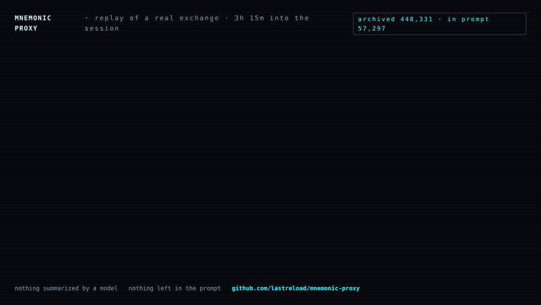

<p align="center">
  
</p>

<h1 align="center">Mnemonic Proxy</h1>

<p align="center"><em>Like Johnny, your agent carries more than its head can hold — and keeps working for hours.</em></p>

<p align="center">
  <a href="LICENSE"></a>
  
  <a href="https://lastreload.github.io/mnemonic-proxy/"></a>
</p>

Mnemonic Proxy lets a coding agent work for hours with a local model, even when the model's context window is small.

Without it, a long session ends in auto-compaction: the agent keeps working from a summary of a summary, slowly
forgets the details, and redoes work or research it had already done.

Mnemonic Proxy works differently. It sits between your agent and your model server. Old tool outputs leave the
prompt, so the window does not fill up. They are not summarized and not thrown away: every message stays on disk,
word for word, and the model can read it back with a `recall` tool when it needs it.

It is for you if you run a local model server (Strata, llama-server, Ollama, LM Studio, Unsloth, ds4-server or
any OpenAI-compatible server) and a coding agent (Claude Code, Codex, opencode, pi, Hermes, Continue), and you are tired
of auto-compaction.

<p align="center">
  
</p>

<p align="center"><sub>A real session, three hours in: one recall call brings back the first version of a code block,
exactly as it was written.</sub></p>

## What it does for you

Measured on our hardware, single runs ([details](docs/benchmarks.md)):

- **Hours on one GPU.** A 3 h 15 min coding session on a single 12 GB GPU: 448K tokens of history, at most 105K in the
  prompt at any time.
- **Better answers than a summary.** On 100 AgentLongBench questions about old tool outputs, the same model answered
  86 right with the proxy in a 32K window, 47 with a model-written summary and 69 with the full history in a larger
  window. A repeat run gave 85, 57 and 75.
- **Fast resume.** A 110K-token conversation comes back from disk in 1.4 s instead of about 50 s, on engines that
  can save their state.

## What it does not do

- It does not make the model smarter. Keeping the text exact does not guarantee that the model looks for it, or
  looks in the right place.
- Search is by words, not by meaning: a paraphrase with no word in common can miss.
- Fast resume needs a server that can save its state: llama-server and Strata (ds4-server keeps its own). The
  other servers get everything else.
- The model still sees one window at a time. The rest is retrievable, not "in context".
- Our numbers come from single runs on our machines. [What we have not proven](docs/limits.md) lists the gaps.

## Quick start

You need:

- Python 3.10 or newer;
- a model server that is already running, with a context window of at least 16K tokens (32K or more is better);
- a model that can call tools, so it can use `recall`.

The proxy does not run a model itself. It talks to your server.

<!-- readme-test: ci -->
```sh
pip install mnemonic-proxy
mnemonic-proxy check --upstream http://127.0.0.1:8095 --port 8096 --data ./data
mnemonic-proxy --upstream http://127.0.0.1:8095 --port 8096 --data ./data
```

`--upstream` is the address of your model server. `check` tells you `READY`, or what to change, line by line.

Then point your agent at the proxy, `http://127.0.0.1:8096/v1`, instead of the server, and turn off the agent's own
auto-compaction (next section).

No model at hand? `uvx mnemonic-proxy demo` shows the archive and `recall` working in one minute, with a scripted
fake model.

## Connect your agent

Two changes in every agent: the address, and its own auto-compaction off, so two context managers do not fight over
the same history.

| agent | point it at | turn off | setup |
|---|---|---|---|
| Claude Code | `ANTHROPIC_BASE_URL=http://127.0.0.1:8096` (no `/v1`) | `DISABLE_AUTO_COMPACT=1` | [Claude Code](docs/agents.md#claude-code-anthropic-messages) |
| Codex | `base_url = "http://127.0.0.1:8096/v1"`, `wire_api = "responses"` | `model_auto_compact_token_limit = 100000000` | [Codex](docs/agents.md#codex-openai-responses) |
| opencode | `http://127.0.0.1:8096/v1` (`openai-compatible` provider) | `"compaction": {"auto": false}` | [opencode](docs/agents.md#opencode-chat-completions) |
| pi, omp | `http://127.0.0.1:8096/v1` (`openai-completions`) | `"compaction": {"enabled": false}` | [pi](docs/agents.md#pi-hermes-continue--chat-completions) |
| Hermes Agent | `http://127.0.0.1:8096/v1` (custom provider) | `compression.enabled: false` | [Hermes](docs/hermes-agent.md) |
| Continue, other Chat Completions clients | `http://127.0.0.1:8096/v1` | the client's own context compaction | [Chat Completions](docs/agents.md#pi-hermes-continue--chat-completions) |

Ollama and LM Studio: give the model a context of 32768 first. With their default (4096 or 8192) they silently drop
part of long prompts. [Engines](docs/engines.md) has the command for each server.

## How it works

1. **Hide.** When the prompt grows, old tool outputs and old reasoning are replaced by a one-line receipt with an id.
   The receipt says what the call was and how it ended.
2. **Keep.** The original text goes to a local SQLite archive, unchanged.
3. **Recall.** The model gets a `recall` tool to search the archive and read any piece back. The proxy answers these
   calls itself; your agent never sees them.
4. **Start a new segment.** If the window still fills up, the model writes handoff notes and continues in a fresh
   segment. The old messages stay in the archive and remain searchable.
5. **Resume fast.** On servers that support it, the engine state is saved to disk, so a long session restarts in
   seconds instead of being read again.

## Privacy

Everything stays on your machine. The proxy talks only to the server you give it, with no telemetry. The archive is
plain text and holds everything the agent saw, secrets included: protect the `data` folder. The proxy listens on
`127.0.0.1` and has no authentication, so do not expose it on a shared network. [Security](docs/security.md)

## Documentation

- [Install and platforms](docs/install.md): Linux, macOS, Windows, WSL, a one-click launcher
- [Agents](docs/agents.md): full setup for each agent, tested versions
- [Engines](docs/engines.md): Strata, llama-server, ds4-server, Ollama, LM Studio, Unsloth, saved state
- [Configuration](docs/configuration.md): every option, and what the automatic configuration picks
- [How it works](docs/how-it-works.md): the long version, step by step
- [Benchmarks](docs/benchmarks.md): the long session, AgentLongBench, recall, saved state
- [What we have not proven](docs/limits.md)
- [Troubleshooting](docs/troubleshooting.md)
- [Tools](docs/tools.md): dashboard, MCP server, `forget`, archive audit
- [Development](docs/development.md): tests, and how this documentation is tested
- [Credits and license](docs/credits.md): thanks, citation

## Credits and license

Developed and benchmarked mainly with [Strata](https://github.com/Niko1221/Strata), by Niko1221 and contributors.
Mnemonic Proxy is maintained independently and also supports the other servers listed above.

MIT license. Author: Maurizio Verde — LastReload.
