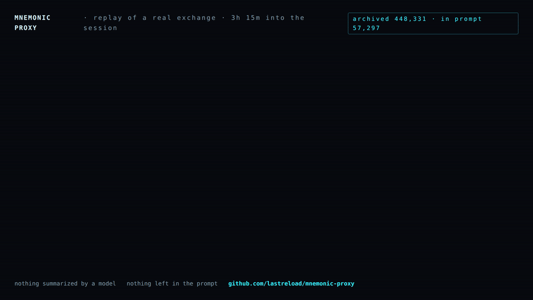
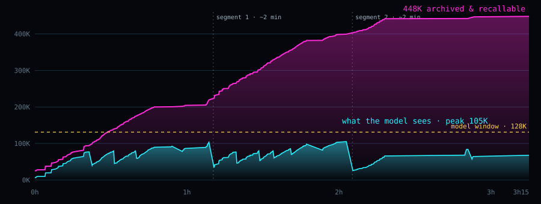

# Benchmarks

## One session, measured

A real coding session — a canvas tower-defense game built from scratch by Qwen3.8 Flash Next (IQ3_XXS) on a single 12 GB
RTX 4070 Ti — with the proxy in between.

  

Replay of a real exchange (animated GIF; <a href="https://raw.githubusercontent.com/lastreload/mnemonic-proxy/main/docs/assets/replay.mp4">MP4</a>).
Three hours and two segment switches into the session, one <code>recall</code> call — resolved inside the proxy in
61 ms — brings back the verbatim first version of the boss block, message 20. The recalled block is returned verbatim.

| | |
|---|---|
| **448K** | tokens of history archived and recallable |
| **105K** | peak tokens actually in the prompt (window: 128K) |
| **3h15** | continuous agent work · 430 requests · 0 errors |
| **1.4 s** | to resume a 110K-token conversation from disk (≈50 s re-reading it) |

  

Magenta: the full history of the session. Cyan: what the model actually reads on each request. Dashed lines: the two
segment switches (≈2 minutes each, written handoff notes). Data from the proxy journal, 5 Oct 2026.

## Benchmark: AgentLongBench with a 32K window

[AgentLongBench](https://github.com/euReKa025/AgentLongBench) (kf-c, tool_response, Count Frequency and Find
Duplicates), 25 questions per type at 64k (~74K-token history) and 128k (~150K): 100 questions, official scorer.
Qwen3.8 Flash Next IQ3_XXS on Strata 0.1.40, one RTX 4070 Ti 12 GB, seed 1. Four methods: the full history in an
81,920 / 163,840-token window, and three ways to fit it into 32,768 tokens — this proxy (0.3.5, commit
[`b8d4920`](https://github.com/lastreload/mnemonic-proxy/commit/b8d4920)), an LLM summary of at most 2,048 tokens
written by the same model, and truncation. Preregistered test: proxy vs summary, exact McNemar. With the question
clarified (one sentence saying which tool output "round N" means; answers and scorer unchanged):

| correct | full window | proxy | summary | truncation |
|---|---|---|---|---|
| 64k (/50) | 38 | **41** | 27 | 23 |
| 128k (/50) | 31 | **45** | 20 | 26 |
| both (/100) | 69 | **86** | 47 | 49 |
| repeat, both (/100) | 75 | **85** | 57 | 62 |

Proxy vs summary: 44 questions right only with the proxy, 5 only with the summary (p = 7.6e-9).
**Repeat run** (31 Oct 2026, proxy 0.3.19, same engine, model, questions, scorer and methods; 64k / 128k: full window
40 / 35, proxy 42 / 43, summary 32 / 25, truncation 32 / 30): proxy vs summary 35 / 7 (+28 points, p = 1.5e-5), vs
truncation 30 / 7 (+23, p = 0.0002), vs full window 22 / 12 (+10, p = 0.12, not significant). The proxy stayed at
85-86 while the other three methods scored 6-13 points higher than in the first run: a single run can be off by that
much, and questions from the same history are not independent. With the original,
ambiguous question every method was near chance (51 / 52 / 56 / 44; answering "0 / no" every time scores 50).
Limits: one model, one engine, one seed, 100 questions; the clarified run exists because of the first one; end to
end the proxy took a median 136 s / 286 s per question (64k / 128k) vs 70 s / 102 s for the full window, mostly
replaying the whole history through the proxy before the question.
Per-question results, logs, scripts and analysis: [mverde73/mnemonic-proxy-agentlongbench](https://huggingface.co/datasets/mverde73/mnemonic-proxy-agentlongbench).

## Recall, benchmarked

71 questions about past sessions, each with the known location of the evidence (including 8 with no answer in the
archive). Held-out split:

| | keyword search | structured recall |
|---|---|---|
| evidence found within 5 calls | 90% | 100% |
| tokens returned per question | 5,940 | 2,737 |
| "not in the archive" recognised | 1 / 4 | 4 / 4 |

The benchmark guided development, so read it as a regression suite, not an independent score. Its archives are real
private sessions and are not in this repository: `bench/` runs against your own archives (`bench/data/<name>.sqlite`)
with questions written for them. Details: [docs/dev-notes/RECALL-RESULT.md](https://github.com/lastreload/mnemonic-proxy/blob/main/docs/dev-notes/RECALL-RESULT.md)
(Italian).

## Saved state, measured

Resuming a conversation instead of re-reading it:

| case | saved | re-read |
|---|---|---|
| Strata (session-files branch), 110K tokens, RTX 4070 Ti | 1.4 s | ≈50 s |
| Strata (session-files branch), 69K tokens, after restart | 2.9 s | 33 s |
| llama-server, 8.2K tokens, CPU, Qwen3-0.6B | 1.9 s | 28.6 s |
| llama-server.exe, native Windows (CI runner), 3.2K tokens, CPU, Qwen3-0.6B | 2.3 s | 35.7 s |

Times are for restoring the conversation's context; loading the model is separate.

### Why saved state matters

A long agent conversation is expensive to rebuild: every token of it has to be processed again (prefill) before the
model can answer. Without saved state that cost is paid again each time the engine loses the conversation — after a
restart, when another client or conversation used the engine in between, and when the proxy returns to a sealed
segment. On a single 12 GB GPU that is close to a minute for 100K tokens; restoring the saved state takes a second or
two, and the state lives on disk, not in VRAM.

This is not specific to the proxy: any client that keeps long conversations on a local engine benefits.
llama-server already offers it through `--slot-save-path`. Strata has it since
[v0.1.40](https://github.com/Niko1221/Strata/releases/tag/v0.1.40) ([PR #668](https://github.com/Niko1221/Strata/pull/668)),
opt-in with `--slot-save-path`. The Strata numbers on this page were measured on our session-files build
(0.1.38 + PR #668, `8d8f664`), before the release. The proxy has since run on Strata 0.1.40 in the
[AgentLongBench benchmark](#benchmark-agentlongbench-with-a-32k-window) and the
[recall tests](#does-the-model-recall-on-its-own), but the restore times in the table above have not been
re-measured on 0.1.40; a contributor measured restore on Strata 0.1.41
([Tools](tools.md#tools-audit-the-archive-and-measure-restore)).

## Claude Code and Codex, live on Strata

0.2.0 in front of Strata (Qwen3.8 Flash Next IQ3_XXS, RTX 4070 Ti 12 GB, 128K window), with the real clients:

| | Claude Code 2.1.284 (Anthropic Messages) | Codex 0.160 (Responses) |
|---|---|---|
| session | 1 h 41 min, 9 steps, 339 requests, **0 proxy errors** | 3 steps, 20 requests |
| prompt tokens served from the engine cache | **92.6%** of 11.36M | **93.9%** of 351K |
| context | 328K virtual, at most 46K in the prompt; 14 segment switches | — |
| `recall` | 22 calls | exact: 36 tests and 8/8 error messages, word for word |

Claude Code ran on a test config with low thresholds (window 64K, masking at 36K) so that segments would switch
within the session. Found live and fixed in 0.3.0: in 3 writes out of 140 the model copied the shortened form of an
old tool argument into a file (see [What we have not proven](limits.md#what-we-have-not-proven)). Report:
[docs/dev-notes/LIVE020-RESULT.md](https://github.com/lastreload/mnemonic-proxy/blob/main/docs/dev-notes/LIVE020-RESULT.md) (Italian).

### Does the model recall on its own?

Recall only helps if the model uses it without being told. We built short scripted tasks where a value the model
needs at the end exists **only** in an old, masked tool output — not on disk, not reproducible — and the final request
never says "remember" or "earlier":

- **A** random output of a setup script (build id, p95, skipped migrations); re-running it gives different values;
- **B** a file read once, then deleted;
- **C** the old version of an overwritten config, no git, no backup;
- **D** an error from a test service that is then shut down;
- **L** a long session: the value appears in turn 0, followed by 12 heavy turns and several segment switches.

Qwen3.8 Flash Next IQ3_XXS on Strata 0.1.40, RTX 4070 Ti 12 GB, proxy 0.3.1 as released (no extra hints):

| client | episodes | right values | via `recall` the model chose to call |
|---|---|---|---|
| Claude Code 2.1.284 | A, B, C, D × 2 | 8 / 8 | 8 / 8 |
| Claude Code 2.1.284 | L: 127K virtual, 3 segment switches | 1 / 1 | yes |
| pi 0.87.1 | A, B, D | 3 / 3 | 3 / 3 |
| pi 0.87.1 | L: 231K virtual, 6 segment switches | 1 / 1 | yes (5 keyword searches) |
| omp 18.10.1 (oh-my-pi) | A, B, C, D | 4 / 4 | 4 / 4 ¹ |
| omp 18.10.1 (oh-my-pi) | L: 82K virtual, 2 segment switches | 1 / 1 | yes (6 calls) |

¹ With omp the model repeated the values in its own one-line answer in B (all three) and D (two of three), so they
stayed visible: there recall was strictly needed only for D's third value. A and C are clean.

A control with the full history in the prompt (no masking) was right in every short episode. In the long one it
re-ran the setup script and wrote the new, wrong values — the proxy run did better. Each episode was checked for the
true values in the final prompt (none were there, except the omp cases in ¹); one file per configuration was also
checked by hand.

Across 8 real sessions (4 pi, 3 Claude Code, 1 Codex; 18 journals counting 10 replays) the need is rare: 5 spontaneous
recalls against 108 after a question about the past; 30 re-reads of a masked, unchanged file (≈37K tokens; ≈46K
counting the replays); 4 edits out of 505 failed because the model
misremembered a masked file. When a file can be re-read, the model re-reads it — which is right when it has changed.

Limits: one model, one run of each long session, scaled-down thresholds (32K window) for the long sessions; Cline
not measured (it cannot resume a session headless without a Cline account). Report:
[docs/dev-notes/RECALL-NEED-RESULT.md](https://github.com/lastreload/mnemonic-proxy/blob/main/docs/dev-notes/RECALL-NEED-RESULT.md)
(Italian).

### Long context on Strata, without the proxy

16 `name=number` facts scattered in a generated Italian story, question at the end, temperature 0, two seeds, from
16K to 122K tokens of prompt: **151/160 exact, 0 wrong** — every miss is an omitted line, all at 64K and above.
Prefill stays at ~2.5K tok/s up to 122K, VRAM flat at 11.6 GB. Same report, section 4.

## User reports

Numbers measured by users on their own hardware and shared with permission. Not reproduced by us.

| | [u/Swimming-Farmer7815](https://www.reddit.com/r/Qwen_AI/comments/1x26aj9/comment/pfb7uu7/) |
|---|---|
| hardware | RTX 5060 Ti 16 GB, Xeon E5-2699 v3, 64 GB DDR4 ECC |
| engine / model | Strata, Swift-Qwen3.8-Flash-Next IQ3_XXS, 128K window |
| client | Cline, with its automatic context compaction disabled |
| session | 13 h; ~280K tokens of total history, ~77K in the last request |
| saved state | ~58K tokens restored in under 4 s (about 1 min 15 s to re-read at the measured prefill rate) |
| `recall` | 8 calls, all 8 results used by the model |

The user reports no compaction pauses during the session. All 8 recalls happened in the last two minutes of the
session, when the user asked for a summary of the day: during normal work the model never called `recall` on its
own. In our tests with Claude Code, pi and omp the model did call `recall` by itself when the value could not be re-read
from disk ([Does the model recall on its own?](#does-the-model-recall-on-its-own)); with Cline we could not test it.

**Share your numbers.** If you run the proxy on your own hardware, a report helps — especially with clients and models
we have not tested (Cline, other models). Useful: GPU/RAM, engine and model, client, session length (total
history and tokens in the last request), restore time, how many `recall` calls and whether the model made them on its
own. `data/journal.jsonl` holds most of it; check it before sharing, it contains your recall queries. Open an issue
with the [user report](https://github.com/lastreload/mnemonic-proxy/issues/new?template=user-report.md) template.

## Written about it

- [Radyz.cz](https://radyz.cz/nazory/mnemonic-proxy-agenticka-pamet-kontextove-okno/) (Czech, 25 Oct 2026):
  *"AI si nepamatuje. Jen si vede spis."* ("AI doesn't remember. It just keeps a file."). An independent review of how
  the proxy works, the session and benchmark numbers with their limits, and the privacy side. It points out that there
  is no command yet to delete a conversation; that is tracked in [#19](https://github.com/lastreload/mnemonic-proxy/issues/19).
